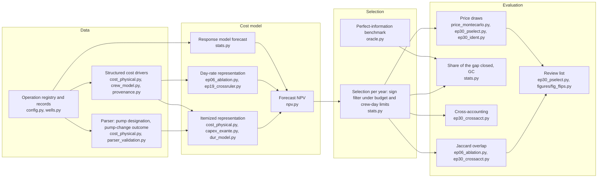
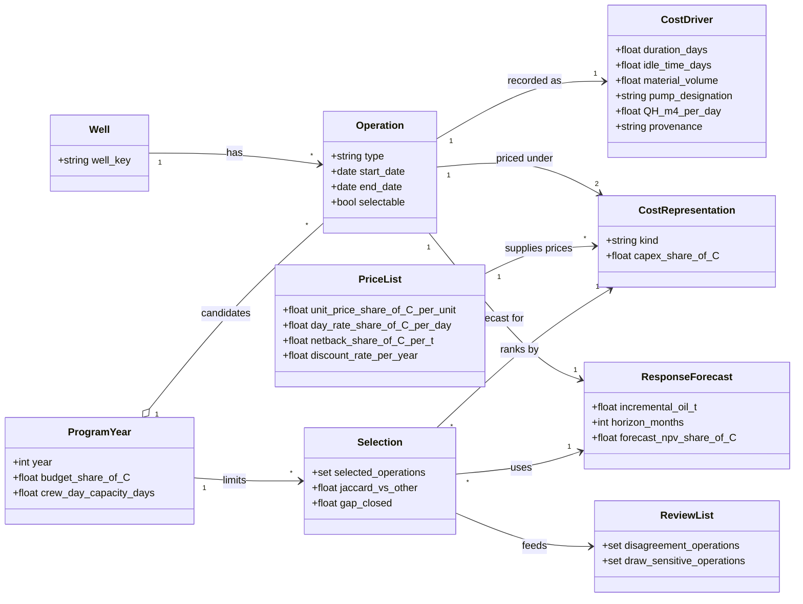

# Auditing cost models in well-intervention selection

Analysis code, a synthetic test set for the pump-designation parser, figure scripts and aggregate result tables for the paper "Auditing Cost Models in Well-Intervention Selection: Reading Cost Drivers from Field Records".

The audit checks the cost model behind a well-intervention program using only what an operation registry already holds. For every candidate operation it reads the cost drivers (durations, idle time, recorded material volumes, pump designation) from the records. It prices them in two cost representations calibrated to the same total CAPEX, itemized (quantities times unit prices) and day-rate (duration times a rate), and runs the same selection under each, and under 500 draws of the price vector. The operations on which the selections disagree, or whose selection flips across price draws, go to an engineer for a cost check. The audit makes no claim about realized workover cost: the registry of the study holds none, so every comparison is between models. It is retrospective, a re-selection among operations that were executed, and it uses records of one operator from one field.

## Contents

- [Pipeline](#pipeline)
- [Quick start](#quick-start)
- [Running the audit on your own records](#running-the-audit-on-your-own-records)
- [Domain model](#domain-model)
- [From the paper to the files](#from-the-paper-to-the-files)
- [Repository layout](#repository-layout)
- [Data statement](#data-statement)
- [Citation](#citation)
- [License](#license)

## Pipeline

Each node names the modules of `src/` that implement it.



## Quick start

The code targets Python 3.12 or later. The steps below need no operator data.

```
git clone https://github.com/ANKOROFF/well-intervention-cost-audit.git
cd well-intervention-cost-audit
python -m venv .venv
source .venv/bin/activate
pip install -r requirements.txt pytest
```

Run the parser on the synthetic test set:

```
python -m pytest tests/test_parser_synthetic.py -q
PYTHONPATH=src python tests/test_parser_synthetic.py --report    # writes results/ep30_parser_synthetic.md
```

All 223 rows are invented. Each row is a pair of pump-designation strings with an expected outcome fixed by construction: same size, different size, or undeterminable. The generator `tests/fixtures/make_parser_synthetic.py` draws delivery and head from two fixed pools of nine round numbers with a fixed seed, and reproduces the file byte for byte. The report shows a full match with the expectation of 0.6996, a match of case and power of 0.8072, and at least one discrepancy in 12 of the 21 classes. Agreement with the expectation is agreement with the labeling instruction. It is not accuracy against the truth.

Regenerate the five figures that need only the tables in `aggregates/`:

```
for f in workflow years waterfall map_by_type budget; do
    PYTHONPATH=src python src/figures/fig_$f.py
done
```

The PNG files appear in `figures/`. Fig. 3 (`fig_flips.py`) needs the confidential tables and is not part of this set.

## Running the audit on your own records

**Inputs.** The code reads parquet tables laid out like `data/` in `src/config.py`. Set `PIPELINE_ROOT` to a working directory, or `PIPELINE_DATA` to the data directory directly. The column names are those read in `src/cost_physical.py` and `src/npv.py`; they are Russian, and [`docs/GLOSSARY.md`](docs/GLOSSARY.md) translates them. Search the code for `pl.read_parquet` to see the schema each step expects. Three kinds of input are required:

| input | content |
|---|---|
| Operation registry | one row per operation: well key, operation type, start and end dates, pump designation before and after the operation (`ESP-delivery-head`, delivery in m3/day, head in m) |
| Recorded cost drivers | monthly production by well (counterfactual and response model), dated equipment events (rig and crew occupancy), regime table of lift equipment, and the material volumes the registry holds: proppant, gel, acid, nitrogen, cement, footage, fracturing stages |
| Price list | twelve unit prices and a scale factor in `cost_physical.Prices`; netback per tonne, crew-season rate, discount rate (0.15 per year) and horizon (24 months) in `npv.Params` |

The unit prices and scenario parameters in the repository are placeholders set to 1.0. Replace them with your own values before running anything.

**Steps.** Run in the order of the dependencies:

1. The cost model and the ex-ante chain: `cost_physical.py`, `capex_exante.py`.
2. The main selection and the benchmark: `ep06_ablation.py`, `ep19_crossruler.py`.
3. The `ep30_*.py` analyses (cross-accounting, price draws, robustness).

Each step rebuilds the chain, reproduces its headline figures within a tolerance before it prints anything new, and writes one report. `PIPELINE_RESULTS`, `PIPELINE_OUT` and `PIPELINE_FIGURES` set where reports, tables and figures go. Some modules check their output against values of the original study, for example the main GC of 0.2631. On other data these checks stop the run by design. Replace the expected values with those of your own first run.

**Outputs.** Reports go to `results/`, aggregate tables (TSV) to `aggregates/` and figures to `figures/`. The review list is the union of the operations selected under one representation only and the operations selected in more than 5% and fewer than 95% of the price draws. The released scripts print counts and shares. `figures/fig_flips.py` builds the per-operation table of the disagreement in a temporary directory and deletes it on exit; remove the final `shutil.rmtree` call to keep it.

**Limits of this release.** The loader of the operator's survey price sheets is withheld. `src/price_registry.py` is a stub, and the steps that reconcile against those sheets raise an error. Identifiers and printed messages inside `src/` are in Russian. Aggregate tables and figure scripts are in English.

## Domain model

The entities the code works with and how they relate. The full definitions are in [`docs/ONTOLOGY.md`](docs/ONTOLOGY.md).



## From the paper to the files

Money columns in `aggregates/` are named `*_pct_C` and are percentages of C, the sum of the CAPEX of the pool of 6,800 operations. C is a unit of scale and is not released. ITM and DR in the tables stand for the itemized and day-rate representations. Operation types use the Latin codes of the paper: PMO pump optimization, SDT sidetracking, HF hydraulic fracturing, BZT bottomhole-zone treatment, RIS remedial isolation works.

| paper item | file in `aggregates/` or script |
|---|---|
| Table 1, populations | `ep30_measure_v3_C.tsv`, `ep30_provenance.tsv`, `ep30_zbs.tsv` |
| Table 2, pump outcomes | `ep30_measure_v3_pump.tsv` |
| Table 3, cross-accounting | `ep30_crossacct.tsv` (selection x valuation, numerator, denominator), `ep30_repr.tsv` |
| Table 4, sides of the disagreement | `table7_disagreement_sides.tsv` |
| Table 5, robustness | sidetracks and drilling rate: `ep30_zbs.tsv`, `ep30_sdt_table.tsv`; price draws: `price_montecarlo_summary.tsv`, `price_montecarlo_multipliers.tsv`; leave one type out: `ep30_loto.tsv`; pump components: `ep30_lambda.tsv`, `lambda_sweep.tsv`; leave one year out, BCa interval, sign-flip test: `ep30_loyo_bca.tsv` |
| Fig. 1, audit workflow | `src/figures/fig_workflow.py` (counts typed from Tables 1 and 3, `ep30_pselect.tsv` and `flips_2024_summary.txt`) |
| Fig. 2, gain by year | `ep30_crossacct_years.tsv` -> `src/figures/fig_years.py` |
| Fig. 3, the 2024 pool | `flips_2024_summary.txt`; `src/figures/fig_flips.py` (needs the confidential tables) |
| Fig. 4, decomposition of the gap | `table8_fig2_decomposition.tsv` -> `src/figures/fig_waterfall.py` |
| Fig. 5, gain by type and leave-one-type-out | `fig5_share_of_gain_by_type.tsv`, `ep30_loto.tsv` -> `src/figures/fig_map_by_type.py` |
| Fig. 6, budget multiplier | `fig6_budget_alpha.tsv` -> `src/figures/fig_budget.py` |

Supplementary Material, best-effort mapping:

| supplement item | file in `aggregates/` |
|---|---|
| cross-accounting, four representations, yearly differences (S3, S16-S18) | `ep30_crossacct.tsv`, `ep30_repr.tsv`, `ep30_crossacct_years.tsv` |
| selection frequency under price draws, identification (S4, S19) | `ep30_pselect.tsv`, `ep30_ident.tsv`, `price_montecarlo_*.tsv` |
| leave-one-type-out, gain by type (S20, S21) | `ep30_loto.tsv`, `fig5_share_of_gain_by_type.tsv` |
| sidetracks, drilling rate, pump multiple (S4, S5, S14) | `ep30_zbs.tsv`, `ep30_sdt_table.tsv`, `ep30_lambda.tsv` |
| disagreement sides (S6) | `table7_disagreement_sides.tsv` |
| response model quality (S7) | `response_quality.tsv` |
| proppant forecast, pump power, parser perturbation (S8, S9, S22) | `ep30_phantom.tsv`, `ep30_pump_contrast.tsv`, `ep30_parser_perturb*.tsv` |
| parser validation, causes, synthetic set (S6) | `ep30_parser_validation.tsv`, `ep30_parser_causes_t1.tsv`, `ep30_parser_causes_t2.tsv`, `ep30_parser_synthetic.tsv` |
| dates of the features, structure tests (S12) | `ep30_feature_dates.tsv`, `ep30_structure.tsv`, `ep30_purge.tsv` |
| provenance of the quantities | `ep30_provenance.tsv`, `ep30_provenance_subset.tsv` |
| intervals and tests (S13), budget grid (S15) | `ep30_loyo_bca.tsv`, `fig6_budget_alpha.tsv` |

## Repository layout

| path | content |
|---|---|
| `src/` | analysis code: parser and cost representations (`cost_physical.py`, `capex_exante.py`, `crew_model.py`, `dur_model.py`), economic model (`npv.py`), response model and selection (`stats.py`, `ep06_ablation.py`, `ep19_crossruler.py`), perfect-information benchmark (`oracle.py`), inference (`stats.py`, `perm_control.py`, `ep30_loyo_bca.py`), price scenarios (`price_montecarlo.py`, `ep30_pselect.py`, `ep30_ident.py`), robustness and structure tests (`ep30_*.py`), decomposition (`ep15_decomposition.py`, `ep27_forced.py`) |
| `src/config.py` | all data locations as placeholders resolved from environment variables |
| `src/figures/` | scripts of Figs. 1-6 and their shared style |
| `tests/test_parser_synthetic.py` | evaluation of the parser on the synthetic set (runs without data) |
| `tests/fixtures/` | the synthetic set (223 rows in 21 classes) and its deterministic generator |
| `tests/test_cost_structure.py` | structural tests of the cost model (need your own tables) |
| `aggregates/` | aggregate result tables (TSV) and the 2024 flip summary |
| `docs/AUDIT_PROCEDURE.md` | the audit procedure in six steps |
| `docs/ONTOLOGY.md` | entities and terms of the domain model |
| `docs/GLOSSARY.md` | Russian names kept in the code, with English translations |

## Data statement

The records the study is computed on belong to an operating company and are confidential. This repository contains no production reports, regime tables, intervention registry, survey workbooks, price registry, well identifiers, field or company names, or amounts in currency, and nothing derived from them at the level of a well, an operation or a row. Every monetary quantity in the released tables is a percentage of C. The numerical results of the paper therefore cannot be reproduced from this repository alone. The operator data can be provided on request in encrypted form, subject to the operator's agreement. Write to the corresponding author, Dmitrii Kornienko (ankoroff57@gmail.com).

## Citation

Kornienko D., Koroteev D., Orlov D., Safonov S. Auditing Cost Models in Well-Intervention Selection: Reading Cost Drivers from Field Records. Paper submitted to SPE Journal.

GitHub shows a "Cite this repository" button from [`CITATION.cff`](CITATION.cff).

## License

The code and the synthetic test set are released under the MIT License (see `LICENSE`). The aggregate tables in `aggregates/` are released under the Creative Commons Attribution 4.0 International license (CC BY 4.0).
